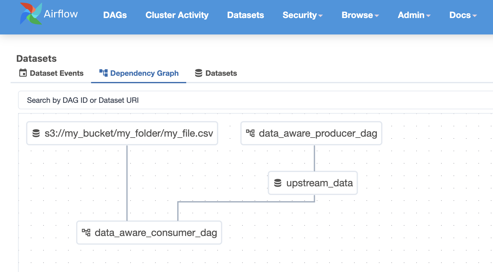

# How to Trigger a DAG using Datasets

## Overview
This guide explains how to trigger Airflow DAGs with Datasets, called **Assets** in Airflow 3. A dataset is a pointer to a piece of data, identified by a URI such as `s3://my_bucket/my_folder/my_file.csv`. A DAG scheduled on a dataset runs every time an event for that dataset is recorded. The event can come from another DAG (a producer) or from an external process (a script, a Lambda function, a CI job) that tells Airflow the data is ready.

The external process does not need to know which DAGs depend on the data: it only says "this data is ready", and every DAG scheduled on it runs.

:::note
The examples import `Asset` from `airflow.sdk`, available in Airflow 3. On Airflow 2 use `from airflow.datasets import Dataset` instead; the rest of the code is the same.
:::

## Producer DAG

A producer DAG updates a dataset, automatically triggering any consumer DAGs subscribed to it.

To implement this, start by creating a DAG and defining the dataset it will update.

```python
# data_aware_producer_dag.py
import datetime

from airflow.decorators import dag, task
from airflow.sdk import Asset

# A dataset can be anything, it will be a pointer in the Airflow db.
# If you need to access url like s3://my_bucket/my_file.txt then you can set
# it with the proper path for reuse.
DAG_UPDATED_DATASET = Asset("upstream_data")

@dag(
    default_args={
        "start_date": datetime.datetime(2024, 1, 1, 0, 0),
        "owner": "Noel Gomez",
        "email": "gomezn@example.com",
        "retries": 3
    },
    description="Sample Producer DAG",
    schedule="0 0 1 */12 *",
    tags=["extract_and_load"],
    catchup=False,
)
def data_aware_producer_dag():
    @task(outlets=[DAG_UPDATED_DATASET])
    def extract_and_load_dlt():
        print("I'm the producer")

    extract_and_load_dlt()


dag = data_aware_producer_dag()
```

That's it, now you are ready to create your [Consumer DAG](#setting-up-the-airflow-dag).

## Trigger from outside Airflow with Datacoves

On Airflow 3 environments, an external process publishes a dataset event with a single request to Datacoves, authenticated with an [API key of the environment](/docs/how-tos/airflow/use-airflow-api#step-2-generate-an-api-key). Datacoves calls the environment's Airflow for it, so the process never handles Airflow credentials. The URL is on the environment's `Environment Keys` page, under `How to use them` > `Trigger asset`.

```bash
curl -X POST "https://api.<your domain>/api/v1/trigger-asset" \
  -H "Authorization: Token $DATACOVES_API_KEY" \
  -H "Content-Type: application/json" \
  -d '{"asset_uri": "s3://my_bucket/my_folder/my_file.csv", "extra": {"rows": 1200}}'
```

```python
import os

import requests

response = requests.post(
    os.environ["DATACOVES_TRIGGER_ASSET_URL"],
    headers={"Authorization": f"Token {os.environ['DATACOVES_API_KEY']}"},
    json={
        "asset_uri": "s3://my_bucket/my_folder/my_file.csv",
        "extra": {"rows": 1200},
    },
    timeout=60,
)
response.raise_for_status()
print(response.json())
```

The request body:

| Field | Required | Description |
| --- | --- | --- |
| `asset_uri` | Yes | The URI of the dataset, exactly as the DAG declares it. |
| `extra` | No | A JSON object stored with the event; DAGs can read it from the triggering event. |
| `partition_key` | No | For partitioned assets. |
| `environment` | No | The environment slug. Environment API keys can only publish to their own environment, so it is only needed with a project key. |

The response is Airflow's: the created event on success. Errors:

| Status | Meaning |
| --- | --- |
| `400` | The request is malformed, or the environment runs Airflow 2 (see below). |
| `401` | The API key is missing, wrong or was deleted. |
| `403` | The key belongs to another environment, or its owner cannot run DAGs in this Airflow. |
| `404` | No dataset with that URI exists in Airflow yet (see the note at the end). |
| `409` | Airflow is not enabled in the environment. |
| `429` | Too many requests with this key; retry after a while. |
| `503` | Airflow could not be reached, for example while it restarts; retry later. |

:::note
On Airflow 2 environments the trigger-asset endpoint is not available. Send the event to Airflow's own API instead: `POST <Airflow API URL>/datasets/events` with `{"dataset_uri": "..."}` and the header `Authorization: Token <API key>`.
:::

## Lambda Function

In this example we will be using an AWS Lambda Function to trigger your DAG once data lands in an S3 Bucket.

### Creating your zip files

To run your python script in a lambda function you need to upload the `requests` library
along with your `lambda_function.py` file.

- Create a python file locally and write out your function. Below is an example function. 

**Example Lambda function:**

```python
import json
import os

import requests

# In Lambda, environment variables are set in the Lambda configuration
# rather than using dotenv
TRIGGER_ASSET_URL = os.environ.get("DATACOVES_TRIGGER_ASSET_URL")
API_KEY = os.environ.get("DATACOVES_API_KEY")


def trigger_asset(asset_uri, extra):
    response = requests.post(
        url=TRIGGER_ASSET_URL,
        headers={"Authorization": f"Token {API_KEY}"},
        json={"asset_uri": asset_uri, "extra": extra},
        timeout=60,
    )
    response.raise_for_status()
    return response.json()


def lambda_handler(event, context):
    print("Lambda execution started")

    try:
        # Extract S3 information
        bucket = event['Records'][0]['s3']['bucket']['name']
        key = event['Records'][0]['s3']['object']['key']
        print(f"File uploaded: {bucket}/{key}")

        # The dataset URI must match the one in the consumer DAG, so if the
        # file name changes, map it to the static URI here.
        asset_uri = f"s3://{bucket}/{key}"

        response = trigger_asset(asset_uri, extra={"bucket": bucket, "key": key})
        print(f"Event posted successfully:\n{json.dumps(response, indent=2)}")

        return {
            'statusCode': 200,
            'body': 'Successfully processed S3 event'
        }
    except Exception as e:
        print(f"ERROR: {str(e)}")
        import traceback
        print(traceback.format_exc())
        return {
            'statusCode': 500,
            'body': f'Error: {str(e)}'
        }
```

- Run the following commands locally to prepare a zip file with everything you need. 

```bash
pip install --target ./package requests
cd package
zip -r ../deployment-package.zip .
cd ..
zip -g deployment-package.zip lambda_function.py
```

### Create a Lambda Function

- Create a new AWS lambda function.
- Set the runtime to Python 3.10.
- Create an IAM role and add the following policy:
    - AmazonS3ReadOnlyAccess to bucket
- Upload `deployment-package.zip` from the earlier step into the Lambda function.

### Set Environment Variables

- Gather your [API key](/docs/how-tos/airflow/use-airflow-api#step-2-generate-an-api-key) and the `Trigger Asset URL` from the environment's `Environment Keys` page. Configure the following environment variables in the Lambda Function's Configuration:

     - `DATACOVES_TRIGGER_ASSET_URL` (the Trigger Asset URL)
     - `DATACOVES_API_KEY` (the API key for authentication)

## Configuring the S3 Event Notification

1. **Go to S3 and Open the Target Bucket**
2. **Create a New Event Notification under the bucket's properties**
   - **Event Name:** `TriggerAirflowDAG`
   - **Prefix (Optional):** Specify a subfolder if needed.
   - **Suffix (Optional)** If you would like to trigger specific files ie) .csv
   - **Event Type:** Select `All object create events`
   - **Destination:** Select **AWS Lambda** and choose the function created earlier.

Now you are ready to set up your Consumer DAG.

## Setting Up the Airflow DAG

Whether you decide to use a producer DAG or an external event, the last step is to create an Airflow DAG that is triggered by a dataset event rather than a schedule. This particular example can be triggered with either a `LAMBDA_UPDATED_DATASET` or `DAG_UPDATED_DATASET`.



### Example DAG

```python
import datetime

from airflow.decorators import dag, task
from airflow.sdk import Asset

LAMBDA_UPDATED_DATASET = Asset("s3://my_bucket/my_folder/my_file.csv")
DAG_UPDATED_DATASET = Asset("upstream_data")

@dag(
    default_args={
        "start_date": datetime.datetime(2024, 1, 1, 0, 0),
        "owner": "Noel Gomez",
        "email": "gomezn@example.com",
        "retries": 1
    },
    description="Sample Consumer DAG",
    schedule=(LAMBDA_UPDATED_DATASET | DAG_UPDATED_DATASET),
    tags=["transform"],
    catchup=False,
)
def data_aware_consumer_dag():
    @task
    def run_consumer():
        print("I'm the consumer")

    run_consumer()


dag = data_aware_consumer_dag()
```


:::note
Ensure the Dataset you are sending an event to exists in Airflow. It will be created automatically when a DAG that uses it is parsed. If a dataset does not exist when the event is sent, the call fails (`404` from the trigger-asset endpoint).
:::
