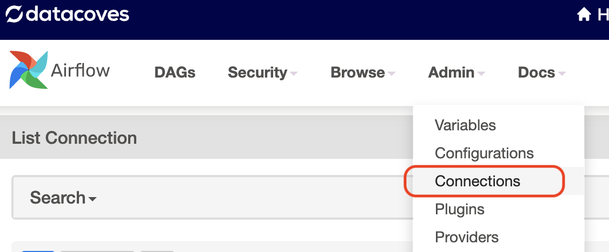
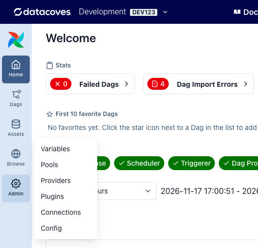
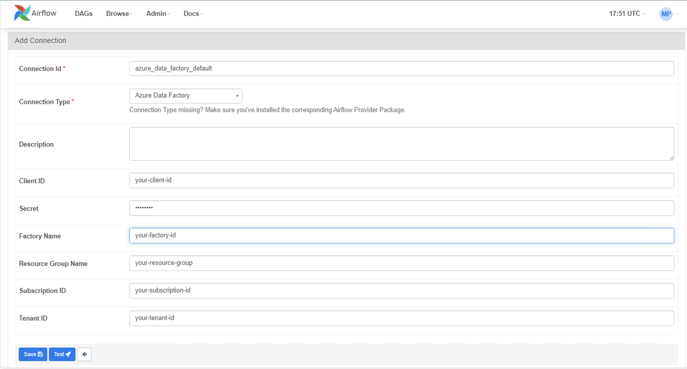
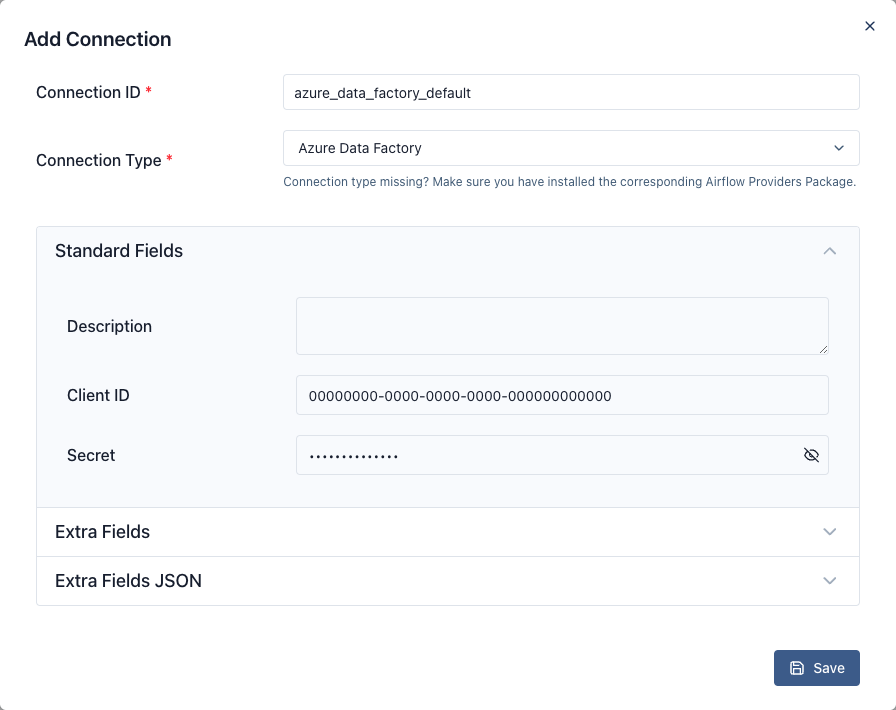
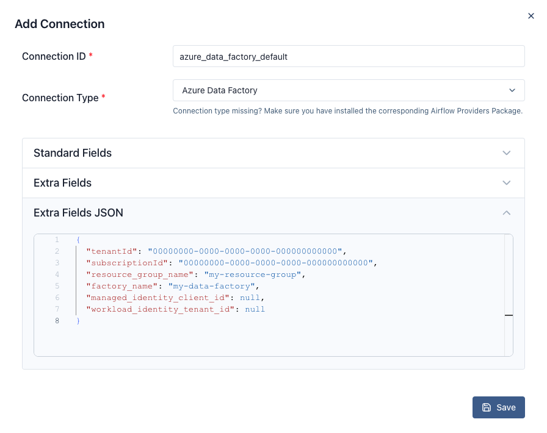
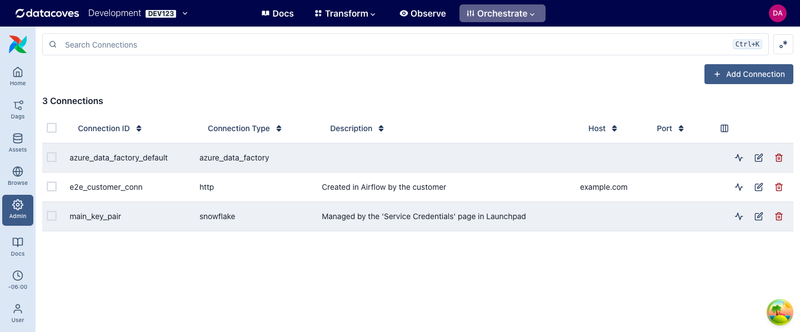

import Tabs from '@theme/Tabs';
import TabItem from '@theme/TabItem';

# Use Microsoft Azure Data Factory Operators 

You can use Airflow in Datacoves to trigger a Microsoft Azure Data Factory pipeline. This guide will walk you through the configuration process. 

## Prerequisites 

-  You will need to set up a [Microsoft Entra Application](https://learn.microsoft.com/en-us/entra/identity-platform/howto-create-service-principal-portal).
-  Assign the `Data Factory Contributor` role to your Microsoft Entra Application. You can do this by heading into Resource Groups and then following [these instructions](https://learn.microsoft.com/en-us/entra/identity-platform/howto-create-service-principal-portal#assign-a-role-to-the-application).
-  Collect the following values from your ADF account, more information on where to find these items in the next section:
   -  `DATA_FACTORY_NAME`
   -  `RESOURCE_GROUP_NAME`
   -  `SUBSCRIPTION_ID`
   -  `APPLICATION_CLIENT_ID`
   -  `TENANT_ID`
   -  `CLIENT_SECRET`

### How to get the ADF information 

**Step 1:**  Login to your Microsoft Azure console and navigate to the [Data Factories service](https://portal.azure.com/#view/HubsExtension/BrowseResource/resourceType/Microsoft.DataFactory%2FdataFactories).

**Step 2:** Copy the`DATA_FACTORY_NAME` for the factory which holds your data pipeline.

**Step 3:** Open the factory and copy the `RESOURCE_GROUP_NAME`, and the `SUBSCRIPTION_ID` from the Overview tab 

**Step 4:** Navigate to the Microsoft Entra ID service, click on number next to *Applicaitons* on the Overview tab. Next click the *All Applications* tab, open the application or register a new application then open it and copy the `APPLICATION_CLIENT_ID` and Directory`TENANT_ID`.

**Step 5:** Click on *Certificates and Secrets* and generate a new secret for your Microsoft Entra Application and copy the *Value*. This is the `CLIENT_SECRET`.

## Create a Microsoft Azure Data Factory Connection in Airflow 

**Step 1:** In Datacoves, a user with the `securityadmin` role opens Airflow's connections. The menu depends on your environment's Airflow version.

<Tabs groupId="airflow-version">
<TabItem value="airflow2" label="Airflow 2" default>

Go to the `Admin -> Connections` menu.



</TabItem>
<TabItem value="airflow3" label="Airflow 3">

In the left sidebar, click `Admin` and then `Connections`.



</TabItem>
</Tabs>

**Step 2:** Create a new connection. The form depends on your environment's Airflow version.

<Tabs groupId="airflow-version">
<TabItem value="airflow2" label="Airflow 2" default>

Create a new connection using the following details.

- **Connection Id:** `azure_data_factory_default` - this name will be used in the Airflow DAG and is the default name used by the ADF Operator

- **Connection Type:** `Azure Data Factory` 

- **Client ID:** Your `APPLICATION_CLIENT_ID` 

- **Secret:**  Your `CLIENT_SECRET` 

- **Tenant ID:** Your `TENANT_ID` 

- **Factory Name**: Your `DATA_FACTORY_NAME`

- **Resource Group Name**: Your `RESOURCE_GROUP_NAME`
  
- **Subscription ID:** Your `SUBSCRIPTION_ID` 

:::note
 Replace the values in the screenshot below with the actual values found above.
:::



</TabItem>
<TabItem value="airflow3" label="Airflow 3">

Click `Add Connection` and fill in:

- **Connection ID:** `azure_data_factory_default` - this name will be used in the Airflow DAG and is the default name used by the ADF Operator
- **Connection Type:** `Azure Data Factory`

Under **Standard Fields**, the connection's login and password:

- **Client ID** (login): Your `APPLICATION_CLIENT_ID`
- **Secret** (password): Your `CLIENT_SECRET`



Open **Extra Fields JSON**. The editor already lists the Azure Data Factory fields with `null` values; replace them with yours. Leave `managed_identity_client_id` and `workload_identity_tenant_id` as `null` when you authenticate with a client secret.

```json
{
  "tenantId": "<TENANT_ID>",
  "subscriptionId": "<SUBSCRIPTION_ID>",
  "resource_group_name": "<RESOURCE_GROUP_NAME>",
  "factory_name": "<DATA_FACTORY_NAME>",
  "managed_identity_client_id": null,
  "workload_identity_tenant_id": null
}
```



After you save it, the connections list shows the connection type by its id, `azure_data_factory`.



</TabItem>
</Tabs>
 
## Example DAG 

:::note
Change `pipeline_name` in the example below to the name of your pipeline. The DAG reads the Resource Group Name and Factory Name from the `azure_data_factory_default` connection, so you don't set them in the code.
:::
Once you have configured your Azure Data Factory connection, you are ready to create your DAG. Head into the `Transform` tab to begin writing your DAG inside `orchestrate/dags`.

<Tabs groupId="airflow-version">
<TabItem value="airflow2" label="Airflow 2" default>

```python
"""
## Run an Azure Data Factory pipeline
Starts an ADF pipeline, then waits for it with a deferrable sensor. While the sensor waits, it runs in
the Airflow triggerer instead of holding a worker slot. The sensor fails if the pipeline run fails.
When the pipeline succeeds, a dbt task runs.

Requires `apache-airflow-providers-microsoft-azure` and an `Azure Data Factory` connection with the
Client ID, Secret, Tenant ID and Subscription ID of a service principal that has the
`Data Factory Contributor` role on the factory's resource group.
Set Resource Group Name and Factory Name in the connection too.
"""

from datetime import timedelta

import pendulum
from airflow.decorators import dag, task, task_group
from airflow.providers.microsoft.azure.operators.data_factory import AzureDataFactoryRunPipelineOperator
from airflow.providers.microsoft.azure.sensors.data_factory import AzureDataFactoryPipelineRunStatusSensor

# The operator and sensor require resource_group_name and factory_name, but None makes the
# hook use the Resource Group Name and Factory Name set in the connection
ADF_ARGS = {
    "azure_data_factory_conn_id": "azure_data_factory_default",
    "resource_group_name": None,
    "factory_name": None,
}


@dag(
    doc_md=__doc__,
    start_date=pendulum.datetime(2025, 1, 1, tz="UTC"),
    schedule="0 0 1 */12 *",  # once a year, Jan 1 at midnight UTC
    catchup=False,
    default_args={
        "owner": "airflow",
        "retries": 2,
        "retry_delay": timedelta(minutes=5),
    },
    description="Trigger an Azure Data Factory pipeline, wait for it with a deferrable sensor, then run dbt",
    tags=["extract_and_load"],
)
def run_adf_pipeline():

    @task_group
    def adf_pipeline(pipeline_name):
        # Start the pipeline and return immediately; the run_id is pushed to XCom
        run_pipeline = AzureDataFactoryRunPipelineOperator(
            task_id="run_pipeline",
            pipeline_name=pipeline_name,
            # parameters={"my_param": "value"},  # only parameters the pipeline declares
            wait_for_termination=False,
            **ADF_ARGS,
        )

        # Wait for the run to finish in the triggerer
        wait_for_pipeline = AzureDataFactoryPipelineRunStatusSensor(
            task_id="wait_for_pipeline",
            run_id=run_pipeline.output["run_id"],
            deferrable=True,
            poke_interval=60,          # seconds between status checks
            timeout=60 * 60 * 2,       # fail if the run takes more than 2 hours
            **ADF_ARGS,
        )

        run_pipeline >> wait_for_pipeline

    # Runs only after both tasks in the group succeed
    @task.datacoves_dbt(
        connection_id="main"
    )
    def run_dbt():
        return "dbt debug"

    adf_pipeline("myTestPipeline") >> run_dbt()


run_adf_pipeline()
```

</TabItem>
<TabItem value="airflow3" label="Airflow 3">

```python
"""
## Run an Azure Data Factory pipeline
Starts an ADF pipeline, then waits for it with a deferrable sensor. While the sensor waits, it runs in
the Airflow triggerer instead of holding a worker slot. The sensor fails if the pipeline run fails.
When the pipeline succeeds, a dbt task runs.

Requires `apache-airflow-providers-microsoft-azure` and an `Azure Data Factory` connection with the
Client ID, Secret, Tenant ID and Subscription ID of a service principal that has the
`Data Factory Contributor` role on the factory's resource group.
Set Resource Group Name and Factory Name in the connection too.
"""

from datetime import timedelta

import pendulum
from airflow.sdk import dag, task, task_group
from airflow.providers.microsoft.azure.operators.data_factory import AzureDataFactoryRunPipelineOperator
from airflow.providers.microsoft.azure.sensors.data_factory import AzureDataFactoryPipelineRunStatusSensor

# The operator and sensor require resource_group_name and factory_name, but None makes the
# hook use the Resource Group Name and Factory Name set in the connection
ADF_ARGS = {
    "azure_data_factory_conn_id": "azure_data_factory_default",
    "resource_group_name": None,
    "factory_name": None,
}


@dag(
    doc_md=__doc__,
    start_date=pendulum.datetime(2025, 1, 1, tz="UTC"),
    schedule="0 0 1 */12 *",  # once a year, Jan 1 at midnight UTC
    catchup=False,
    default_args={
        "owner": "airflow",
        "retries": 2,
        "retry_delay": timedelta(minutes=5),
    },
    description="Trigger an Azure Data Factory pipeline, wait for it with a deferrable sensor, then run dbt",
    tags=["extract_and_load"],
)
def run_adf_pipeline():

    @task_group
    def adf_pipeline(pipeline_name):
        # Start the pipeline and return immediately; the run_id is pushed to XCom
        run_pipeline = AzureDataFactoryRunPipelineOperator(
            task_id="run_pipeline",
            pipeline_name=pipeline_name,
            # parameters={"my_param": "value"},  # only parameters the pipeline declares
            wait_for_termination=False,
            **ADF_ARGS,
        )

        # Wait for the run to finish in the triggerer
        wait_for_pipeline = AzureDataFactoryPipelineRunStatusSensor(
            task_id="wait_for_pipeline",
            run_id=run_pipeline.output["run_id"],
            deferrable=True,
            poke_interval=60,          # seconds between status checks
            timeout=60 * 60 * 2,       # fail if the run takes more than 2 hours
            **ADF_ARGS,
        )

        run_pipeline >> wait_for_pipeline

    # Runs only after both tasks in the group succeed
    @task.datacoves_dbt(
        connection_id="main"
    )
    def run_dbt():
        return "dbt debug"

    adf_pipeline("myTestPipeline") >> run_dbt()


run_adf_pipeline()
```

</TabItem>
</Tabs>

## Understanding the Airflow DAG 

- Understand how to [authenticate with ADF](https://airflow.apache.org/docs/apache-airflow-providers-microsoft-azure/stable/connections/adf.html).
- The DAG makes use of the [AzureDataFactoryRunPipelineOperator](https://airflow.apache.org/docs/apache-airflow-providers-microsoft-azure/stable/operators/adf_run_pipeline.html) to start the Azure Data Factory pipeline. With `wait_for_termination=False` the task finishes as soon as the run starts and pushes its `run_id` to XCom.
- To pass values to the pipeline, uncomment `parameters`. Use only parameters that your pipeline declares.
- The `AzureDataFactoryPipelineRunStatusSensor` waits for that `run_id`. With `deferrable=True`, the wait runs in the Airflow triggerer instead of holding a worker slot. It checks the run every `poke_interval` seconds (60) and fails if the pipeline run fails, is cancelled, or takes longer than `timeout` (2 hours).
- Both tasks are in a reusable task group, `adf_pipeline`, so you can call it once per pipeline.
- `run_dbt` runs only after the pipeline succeeds. Replace `dbt debug` with the dbt command you need. See [Run dbt](./run-dbt.md) for more on the `datacoves_dbt` decorator.
