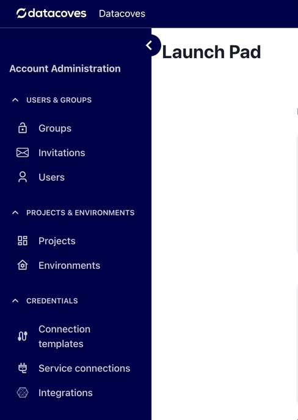
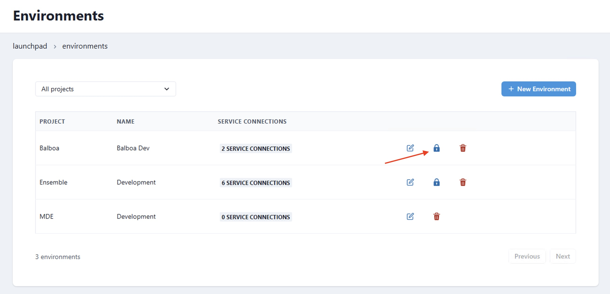
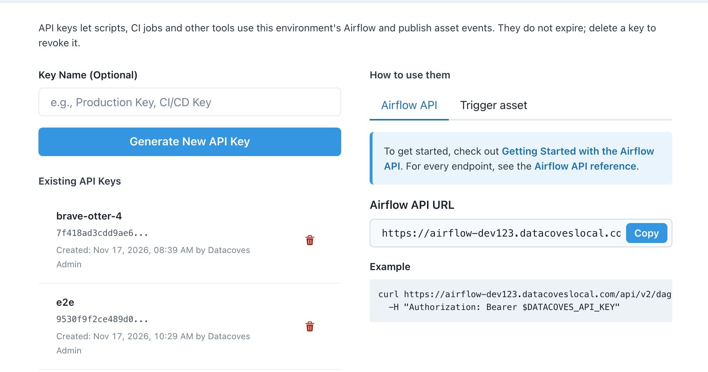

# How to use the Airflow API

:::warning
 Users must have Project Level Admin Group to use the Airflow API. The API will allow you to view secrets values in plain text. Always exercise the principle of least privilege. 
:::
This how to will walk you through getting an API key for an environment and using it with the Airflow API.

## Step 1: Navigate to your target environment

- A user with the appropriate access can navigate to the `Environments` in the navigation menu.



- Then Select the Pad lock icon for the Airflow environment you wish to access. It opens the environment's `Environment Keys` page.




## Step 2: Generate an API key

Generate your API key and copy it somewhere secure. Once you click away it will not be shown again.



API keys do not expire. To revoke one, delete it from the list: Datacoves rejects it right away, and Airflow 3 stops accepting it within a minute. Create one key per integration (for example one per CI pipeline) so you can revoke them independently.

The same key works with the Airflow API and, on Airflow 3, with the [trigger-asset endpoint](/docs/how-tos/airflow/api-triggered-dag#trigger-from-outside-airflow-with-datacoves) that publishes asset events.

:::note
Airflow 3 environments used to issue Airflow tokens on this page. They are listed under `Legacy Airflow Tokens` until they expire, and Airflow keeps accepting each one until then, even after you remove it from the list. Move your integrations to an API key.
:::

## Step 3: Copy the API URL

On the right of the same page, under `How to use them`, copy the `Airflow API URL`. Airflow 2 and Airflow 3 differ in the URL and in how the key is sent:

| | Airflow 2 | Airflow 3 |
| --- | --- | --- |
| API URL | `https://api-airflow-<environment>.<your domain>/api/v1/` | `https://airflow-<environment>.<your domain>/api/v2/` |
| Header | `Authorization: Token <API key>` | `Authorization: Bearer <API key>` |

```bash
# Airflow 3
curl "$AIRFLOW_API_URL/dags" -H "Authorization: Bearer $DATACOVES_API_KEY"

# Airflow 2
curl "$AIRFLOW_API_URL/dags" -H "Authorization: Token $DATACOVES_API_KEY"
```

## Step 4: Add your credentials to a .env file

Create a `.env` file inside your `orchestrate/` directory and be sure to add the file to your `.gitignore`. Add your credentials there.

```ini
AIRFLOW_API_URL = "https://..."
DATACOVES_API_KEY = "...."
# 3 for Airflow 3, 2 for Airflow 2
AIRFLOW_VERSION = "3"
```

## Step 5: Use it in a python script

Below is a sample script that makes use of the Airflow API.

**This script does the following:**
- Initializes the Airflow API client using authentication details from environment variables.

- Fetches a list of all DAGs from the Airflow API.

- Prints a sorted list of DAG IDs for better readability.

- Triggers a new DAG run for a specified DAG using the API.

To publish asset (dataset) events from outside Airflow, see [How to trigger a DAG using Datasets](/docs/how-tos/airflow/api-triggered-dag).

```python
# airflow_api_call.py
import json
import os

import requests
from dotenv import load_dotenv

load_dotenv()
API_URL = os.getenv("AIRFLOW_API_URL").rstrip("/")
API_KEY = os.getenv("DATACOVES_API_KEY")
AIRFLOW_VERSION = os.getenv("AIRFLOW_VERSION", "3")

# Airflow 3 takes the API key as a bearer, Airflow 2 as a Datacoves token.
AUTH_SCHEME = "Bearer" if AIRFLOW_VERSION == "3" else "Token"
HEADERS = {"Authorization": f"{AUTH_SCHEME} {API_KEY}"}


def trigger_dag(dag_id):
    body = {"note": "Trigger from API"}
    if AIRFLOW_VERSION == "3":
        # Airflow 3 requires the logical date; None runs it now.
        body["logical_date"] = None

    response = requests.post(
        url=f"{API_URL}/dags/{dag_id}/dagRuns",
        headers=HEADERS,
        json=body,
    )
    response.raise_for_status()
    return response.json()


def list_dags():
    response = requests.get(url=f"{API_URL}/dags", headers=HEADERS)
    response.raise_for_status()

    # Extract just the DAG names from the response, sorted for readability
    return sorted(dag["dag_id"] for dag in response.json()["dags"])


def print_response(response):
    if response:
        msg = json.dumps(response, indent=2)
        print(f"Response:\n{'='*30}\n\n {msg}")


if __name__ == "__main__":
    # Trigger a DAG
    # response = trigger_dag("bad_variable_usage")
    # print_response(response)

    # List DAGs
    print_response(list_dags())
```
