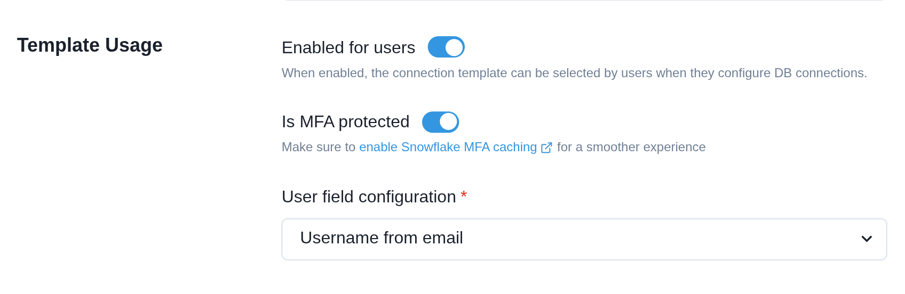
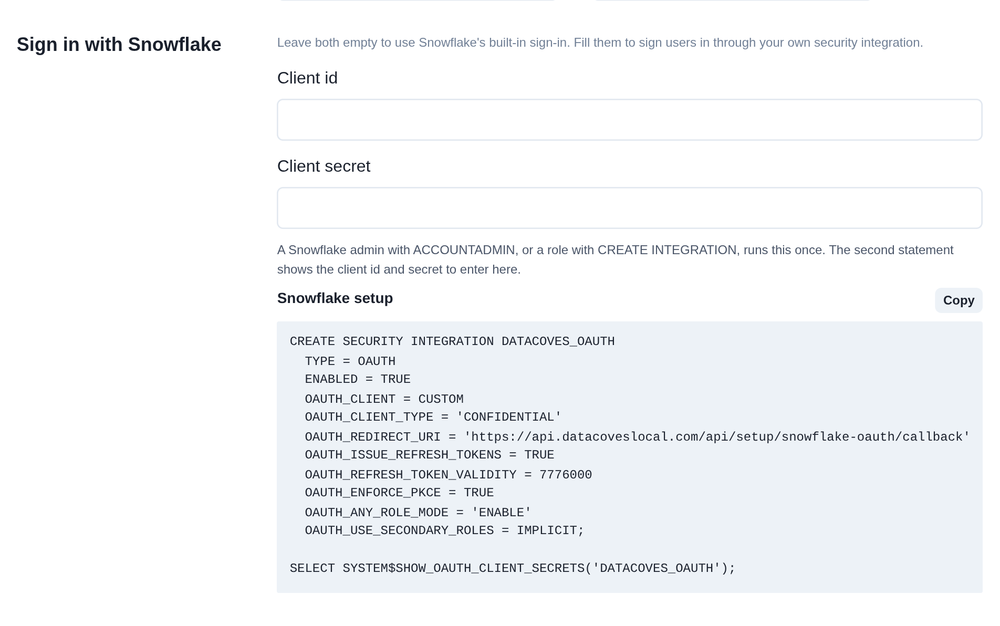
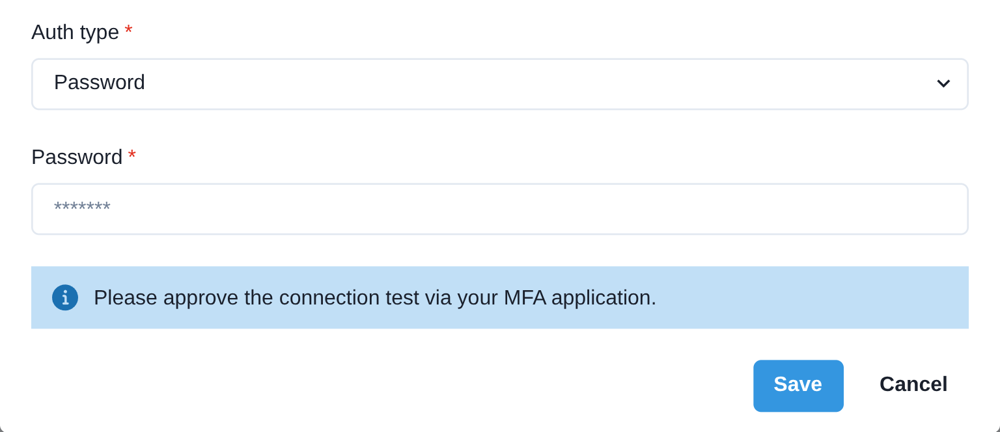
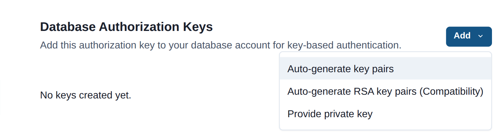
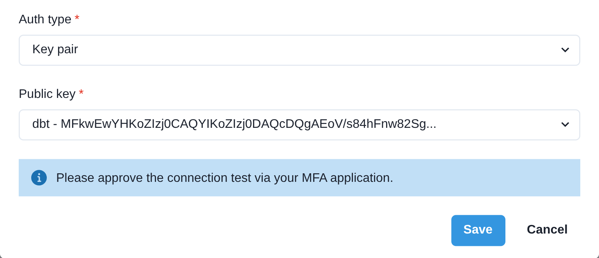
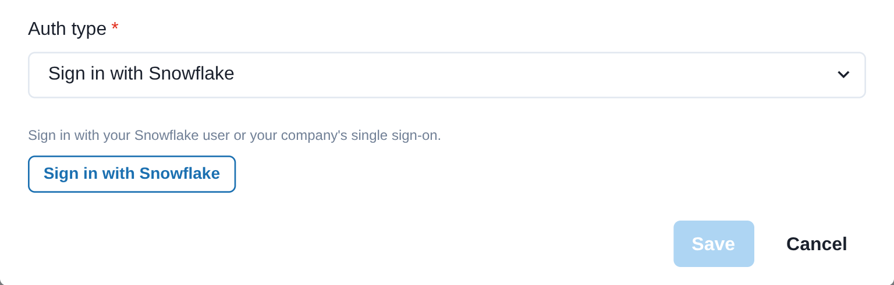
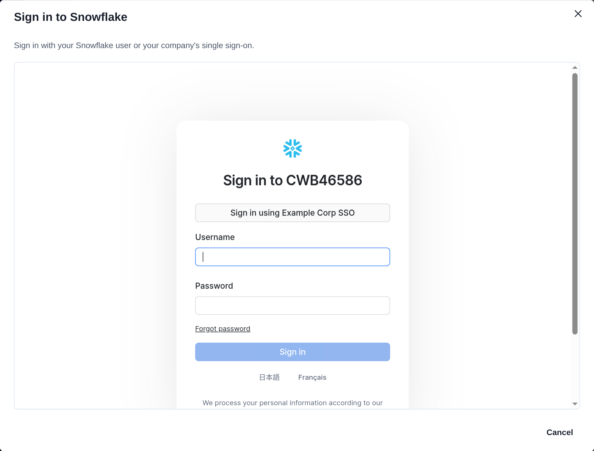
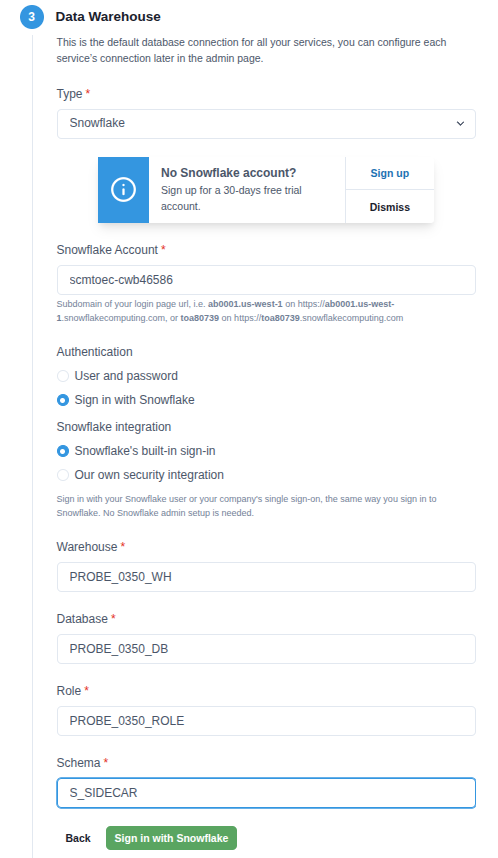
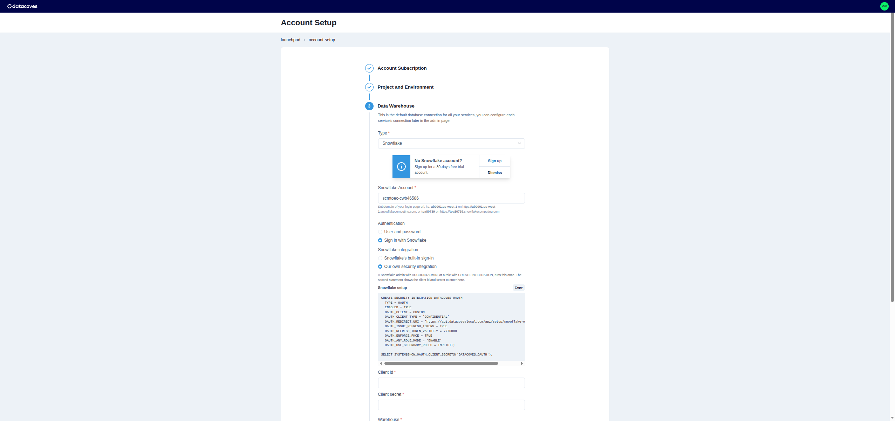

import Tabs from '@theme/Tabs';
import TabItem from '@theme/TabItem';

# How to connect Datacoves to Snowflake

Datacoves connects dbt, the Snowflake extension, Datacoves Copilot and Airflow to Snowflake in one of three ways:

- **Username and password with MFA.** Snowflake is
  [making MFA mandatory](https://docs.snowflake.com/en/user-guide/security-mfa-rollout) for every password
  sign-in.
- **Key pair.** The user signs in with a private key; Snowflake holds the public key.
- **Sign in with Snowflake (OAuth).** The user signs in the way they sign in to Snowflake, with their Snowflake
  user or your company's single sign-on. It is the option for accounts where users have no password.

An admin sets up the connection template first. Each user then adds their own connection in **Settings >
Database Connections**. Airflow uses [service connections](#airflow-service-connections), which can also use
workload identity.

## Connection template setup

Admins create the template in **Connection Templates** (see
[Configure Connection Templates](/docs/how-tos/datacoves/how_to_connection_template)). Turn on **Enabled for
users** so users can pick it.

<Tabs groupId="snowflake-auth">
<TabItem value="password" label="Password with MFA" default>

Turn on **Is MFA protected**. dbt then signs in with `authenticator: username_password_mfa`, and users approve
each connection test in their MFA app.



To cut down on MFA prompts, a Snowflake admin turns on MFA token caching for the account. A cached token is valid
for up to four hours ([Snowflake MFA token caching](https://docs.snowflake.com/en/user-guide/security-mfa#using-mfa-token-caching-to-minimize-the-number-of-prompts-during-authentication-optional)):

```sql
ALTER ACCOUNT SET ALLOW_CLIENT_MFA_CACHING = TRUE;
```

</TabItem>
<TabItem value="key-pair" label="Key pair">

Set **User field configuration** to any value except **Provided by user**. Users are offered the key pair only
when Datacoves fills in their Snowflake username from the template.


</TabItem>
<TabItem value="sign-in" label="Sign in with Snowflake">

Under **Sign in with Snowflake**, leave **Client id** and **Client secret** empty to use
[Snowflake's built-in sign-in](#snowflakes-built-in-sign-in), or enter the client of
[your own security integration](#your-own-security-integration). Every connection on the template then signs in
through it.



</TabItem>
</Tabs>

## User settings

Each user opens **Settings > Database Connections**, clicks **Add** on the environment, picks the connection
template and chooses the **Auth type**.

<Tabs groupId="snowflake-auth">
<TabItem value="password" label="Password with MFA" default>

Enter your Snowflake password and save. When the template is MFA protected, approve the connection test in your
MFA app.



</TabItem>
<TabItem value="key-pair" label="Key pair">

First add a key in **Settings > Database Auth Keys**: **Add**, then **Auto-generate key pairs**,
**Auto-generate RSA key pairs (Compatibility)** or **Provide private key**.



Then choose **Key pair** as the auth type and pick the key under **Public key**.



Your Snowflake user needs the public key, without the `BEGIN` and `END` lines:

```sql
ALTER USER <your Snowflake user> SET RSA_PUBLIC_KEY = '<your public key>';
```

</TabItem>
<TabItem value="sign-in" label="Sign in with Snowflake">

Choose **Sign in with Snowflake** and click the sign-in button.



The sign-in opens in a dialog in Datacoves. Sign in the way you sign in to Snowflake. Passkeys aren't available
in the dialog; pick another method, such as an authenticator app.



</TabItem>
</Tabs>

## The setup wizard

The Data Warehouse step of the setup wizard offers **User and password**, with **Is MFA protected**, and **Sign
in with Snowflake**, with Snowflake's built-in sign-in or your own security integration. A key pair is added
afterwards in the user settings.



## Sign in with Snowflake

### Snowflake's built-in sign-in

Needs no Snowflake admin setup. Datacoves signs in through Snowflake's `SNOWFLAKE$LOCAL_APPLICATION`
integration. Check that your account has it:

```sql
SHOW SECURITY INTEGRATIONS LIKE 'SNOWFLAKE$LOCAL_APPLICATION';
```

### Your own security integration

Use it when your admins want their own OAuth integration, with its own refresh token validity and role rules.
A Snowflake admin with `ACCOUNTADMIN`, or a role with the `CREATE INTEGRATION` privilege, runs this once.
Datacoves shows the same statements, with your cluster's redirect URI filled in and a copy button, in the
setup wizard and on the connection template form.



```sql
CREATE SECURITY INTEGRATION DATACOVES_OAUTH
  TYPE = OAUTH
  ENABLED = TRUE
  OAUTH_CLIENT = CUSTOM
  OAUTH_CLIENT_TYPE = 'CONFIDENTIAL'
  OAUTH_REDIRECT_URI = 'https://api.<your Datacoves domain>/api/setup/snowflake-oauth/callback'
  OAUTH_ISSUE_REFRESH_TOKENS = TRUE
  OAUTH_REFRESH_TOKEN_VALIDITY = 7776000
  OAUTH_ENFORCE_PKCE = TRUE
  OAUTH_ANY_ROLE_MODE = 'ENABLE'
  OAUTH_USE_SECONDARY_ROLES = IMPLICIT;

SELECT SYSTEM$SHOW_OAUTH_CLIENT_SECRETS('DATACOVES_OAUTH');
```

- `OAUTH_CLIENT = CUSTOM` and `OAUTH_CLIENT_TYPE = 'CONFIDENTIAL'` make an integration that Datacoves
  authenticates to with a client id and secret.
- `OAUTH_REDIRECT_URI` is where Snowflake sends the browser after sign-in. It is `https://api.` plus the
  domain of your Datacoves cluster, the domain in your Datacoves address, and the path above.
- `OAUTH_ISSUE_REFRESH_TOKENS` and `OAUTH_REFRESH_TOKEN_VALIDITY` let dbt and Airflow keep working without
  signing in again. The validity is in seconds: 86400 (1 day) to 7776000 (90 days). Snowflake Support raises
  the maximum on request.
- `OAUTH_ENFORCE_PKCE` requires PKCE on every sign-in.
- `OAUTH_ANY_ROLE_MODE` and `OAUTH_USE_SECONDARY_ROLES` let dbt switch roles inside a session, as it does with
  a password or a key pair.
- `SYSTEM$SHOW_OAUTH_CLIENT_SECRETS` returns the client id and secret. Enter them in the setup wizard, or on
  the connection template under **Sign in with Snowflake**.

Snowflake blocks `ACCOUNTADMIN`, `SECURITYADMIN`, `GLOBALORGADMIN` and `ORGADMIN` in OAuth sessions by
default. Use another role for dbt and Airflow.

### When a sign-in expires

A sign-in lasts as long as the integration's `OAUTH_REFRESH_TOKEN_VALIDITY`. When one expires, is about to
expire, or Snowflake revokes it, the Launchpad shows a banner with **Sign in again**, and the connection lists
show a badge. Signing in again restarts your workspace with the new sign-in. An Airflow service connection is
signed in again from its edit page.

Single-use refresh tokens (`OAUTH_SINGLE_USE_REFRESH_TOKENS_REQUIRED = TRUE`) are not supported. Datacoves
shows the `ALTER SECURITY INTEGRATION` statement that turns them off when it finds them.

### Network policies

Token requests come from Datacoves' addresses, so Snowflake network policies have to allow them. The setup SQL
panel lists the addresses when your cluster has them configured.

## Airflow service connections

A [service connection](/docs/how-tos/datacoves/how_to_service_connections) picks its **Authentication
mechanism**. With the Environment Variables delivery mode only **Password** is offered. With the Airflow
Connection delivery mode the service connection can also use a key pair, Sign in with Snowflake and, for Airflow,
workload identity.

<Tabs groupId="snowflake-auth">
<TabItem value="password" label="Password" default>

Enter the user's password. Snowflake
[blocks passwords for service users](https://docs.snowflake.com/en/user-guide/security-mfa-rollout), so a
Snowflake service user (`TYPE = SERVICE`) takes one of the other mechanisms.

</TabItem>
<TabItem value="key-pair" label="Key pair">

Choose **Key-pair**, then auto-generate a key or provide a private key. Add the public key to the Snowflake user
by hand. See [Key-Pair Authentication in Airflow](/docs/how-tos/airflow/use-key-pair-authentication).

</TabItem>
<TabItem value="sign-in" label="Sign in with Snowflake">

Choose **Sign in with Snowflake** and sign in. Airflow runs as the Snowflake user who signed in.

</TabItem>
<TabItem value="workload-identity" label="Workload identity">

Choose **Workload identity**. Airflow signs in with no secret at all: Snowflake trusts your environment's
Airflow as one service user. The form shows the statement to run, with the issuer and subject of your
environment filled in:

```sql
CREATE USER AIRFLOW_SERVICE
  WORKLOAD_IDENTITY = (
    TYPE = OIDC
    ISSUER = '<issuer shown in the form>'
    SUBJECT = '<subject shown in the form>'
  )
  TYPE = SERVICE
  DEFAULT_ROLE = TRANSFORMER;

GRANT ROLE TRANSFORMER TO USER AIRFLOW_SERVICE;
```

Turn Airflow on in the environment before you create the connection, so the form can show the issuer and
subject.

</TabItem>
</Tabs>
