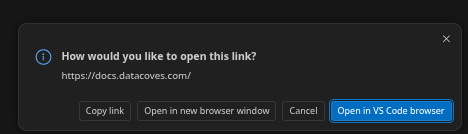

# How to open links from VS Code

When you Ctrl-click (Cmd-click on Mac) a link in the VS Code terminal or editor, a popup asks where to open
it:

## Open in VS Code browser

Opens the link in a VS Code tab.

## Open in new browser window

Opens the link in a new tab of your browser.

## Copy link

Copies the link. The status bar shows `Link copied to the clipboard.`

## Cancel

Closes the popup without opening the link. Escape does the same.

## Sign-in pages

Links opened by terminal commands, like the sign-in page of `claude auth login`, and by other VS Code
extensions show the same popup. A sign-in page that returns to `localhost` when you finish only completes in the VS Code
browser.
