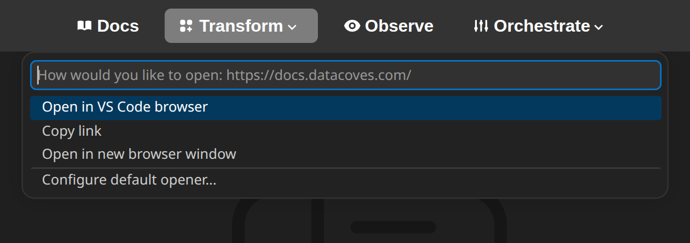

# How to open links from VS Code

Ctrl-clicking a link (Cmd-click on Mac) in the VS Code terminal or editor opens a picker that asks how you
want to open it:

The picker shows the URL and 4 choices. A `localhost` URL adds a fifth one, `Open in Simple Browser`.

## Open in VS Code browser

Opens the link in a tab inside VS Code. This is the Datacoves browser.

## Copy link

Copies the URL to the clipboard. The status bar shows `Link copied to the clipboard.`

## Open in new browser window

Opens the URL in a new browser tab.

## Configure default opener...

Opens your user settings in the `workbench.externalUriOpeners` setting, where you map a URL pattern to the
opener to use. Links that match a pattern open there without the picker.

Press Escape to close the picker and open nothing.

## Sign-in pages

Sign-in pages, such as `https://github.com/login/device`, show the same picker. A sign-in page that finishes
on a `localhost` callback only completes when you open it in the VS Code browser.
