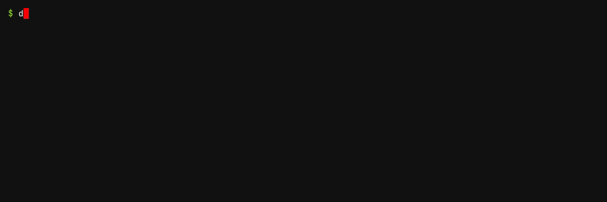
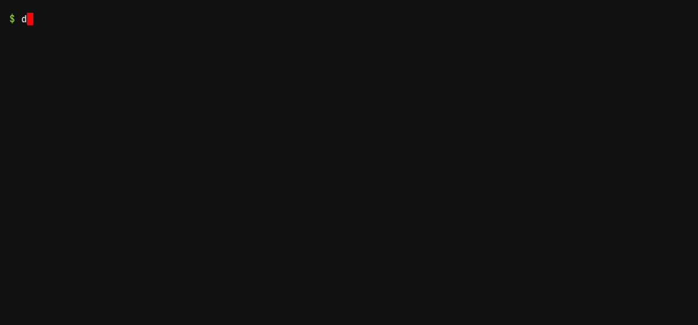

# Datacoves CLI Commands

The `datacoves` command line tool is pre-installed in your Datacoves VS Code workspace and is meant to simplify your workflow. Run it from the VS Code terminal.

Use `--help` on any command or subcommand to see its usage and options:

```bash
datacoves --help
datacoves my --help
datacoves my parse-logs --help
```

| Command | Description |
|---|---|
| [`datacoves check_size_folder`](#datacoves-check_size_folder) | Check size of a directory. |
| [`datacoves my import`](#datacoves-my-import) | Import connections and variables from Team Airflow into My Airflow. |
| [`datacoves my pytest`](#datacoves-my-pytest) | Run pytest in My Airflow. |
| [`datacoves my db-clean`](#datacoves-my-db-clean) | Delete old records from the My Airflow database. |
| [`datacoves my parse-logs`](#datacoves-my-parse-logs) | Show My Airflow DAG parsing times, or the parse log of one DAG file. |
| [`datacoves my api-key`](#datacoves-my-api-key) | Manage My Airflow API keys. |

`datacoves --help` also links to this page.

## Tab completion

Press `Tab` in the VS Code terminal to complete `datacoves` commands, subcommands and options. Press it twice to list what is available.



Tab completion is enabled by default in every new terminal since Datacoves 6.1. On earlier versions, run `datacoves --install-completion` once and open a new terminal. `datacoves --show-completion` prints the completion script instead, in case you want to add it to your shell configuration yourself.

## datacoves check_size_folder

Analyzes a directory and prints a summary of what is taking up space. This is useful when your workspace is running low on disk space and you need to find large folders or files (for example `target/`, `logs/` or `dbt_packages/`).

| Option | Description |
|---|---|
| `--folder` | **Required.** Path to the folder to analyze, absolute or relative to your current directory. |

```bash
# The current directory
datacoves check_size_folder --folder .

# The target folder of the dbt project you are in
datacoves check_size_folder --folder target
```


The report includes:

- The total number of subdirectories (at all levels) and files, and the total size of the folder
- The size of each first-level subdirectory, largest first
- The 10 most common file extensions
- The 5 largest files over 10 MB, if there are any

Hidden folders such as `.git` are included in the totals. This command only reads the folder. It does not modify or delete anything.

## datacoves my

The `my` subcommand executes commands for [My Airflow](/docs/how-tos/my_airflow), your personal Airflow instance for developing and testing DAGs.

:::note
My Airflow [must be started](/docs/how-tos/my_airflow/start-my-airflow) and fully running for `datacoves my pytest`, `datacoves my db-clean` and `datacoves my parse-logs` to work. Otherwise you will see `You must start My Airflow and let it fully start up first.`
:::

### datacoves my import

Imports your variables and connections from Team Airflow into My Airflow. You only need to run it once, or whenever new variables or connections are added to Team Airflow. See [Import variables and connections](/docs/how-tos/my_airflow/my-import) for a walkthrough.

:::note
[Start My Airflow](/docs/how-tos/my_airflow/start-my-airflow) and let it fully start up before running this command.
:::

```bash
datacoves my import
```

| Option | Description |
|---|---|
| `-v`, `--variables` | Only import variables. |
| `-c`, `--connections` | Only import connections. |
| `-f`, `--force` | Force import even if the variable or connection already exists. |
| `-q`, `--quiet` | Don't interactively ask for secrets. |

By default both variables and connections are imported, and items that already exist in My Airflow are skipped. Use `--force` to overwrite them.

```bash
# Only re-import variables, overwriting existing ones
datacoves my import --variables --force
```



#### Secret variables

For security purposes, secret values are not imported automatically. A variable is treated as secret when its name contains words such as `password`, `secret`, `token`, `api_key` or `private_key`.

For each secret variable, the command asks you to enter its value. Type or paste the value (it can span several lines), press `Enter`, and then press `Ctrl-D` to finish. With `--force`, you are asked again for every secret value. With `--quiet`, secret variables are created with an empty value instead, so you need to set them later in My Airflow.

#### Connections

My Airflow uses your own credentials, not the service credentials used by Team Airflow. For each supported Team Airflow connection, the command creates a connection with the same ID in My Airflow using the details and credentials from your [database connection](/docs/how-tos/vs-code/initial#set-up-database-connection) in your Datacoves User Settings. Snowflake, Redshift, Databricks and BigQuery connections are supported.

- If you have more than one database connection of the same type, you will be asked to choose one. With `--quiet`, the first one is used.
- If you don't have a database connection of the right type, or the connection type is not supported, the connection is skipped with a warning and you need to add it manually in My Airflow.
- If you have no database connection configured at all, the command stops and asks you to set one up in your User Settings. You can still import only variables with `--variables`.

### datacoves my pytest

Runs [pytest](https://docs.pytest.org/) inside My Airflow, so your tests run with the same Python environment and Airflow installation your DAGs use. Tests run against the files in your workspace, including changes you haven't committed. The command runs from the root of your repository, so paths are relative to the repository root, not to your current directory.

Create your test files (for example inside the `orchestrate` directory), then pass the file path as an argument. Everything after `--` is passed directly to pytest:

```bash
datacoves my pytest -- orchestrate/test_dags/validate_dags.py
```

You can pass any pytest options. The `--` is required when you do, otherwise the options are rejected by `datacoves` instead of being passed to pytest:

```bash
datacoves my pytest -- orchestrate/test_dags/validate_dags.py -k test_dag_tags -v
```


:::note
The pytest output is shown when the run finishes, not while it runs. Read it to see whether your tests passed: the exit code of `datacoves my pytest` is always `0`, even when tests fail.
:::

See [Test DAGs](/docs/how-tos/airflow/dags/test-dags) for examples of DAG validation tests.

### datacoves my db-clean

Deletes old records, such as DAG runs, task instances, XComs and audit log entries, from the My Airflow metadata database. Use it to remove run history you no longer need.

| Option | Description |
|---|---|
| `--days` | Number of days to keep. Records older than this are deleted. Default: `5`, minimum: `1`. |

```bash
# Keep only the last 5 days (default)
datacoves my db-clean

# Keep only the last day
datacoves my db-clean --days 1
```


:::warning
The cleanup runs without asking for confirmation, and deleted records are not archived. They cannot be recovered.
:::

My Airflow keeps running while the database is cleaned: the records of its running scheduler, triggerer and DAG processor are never deleted. Before Datacoves 6.1, running `db-clean --days 0` deleted them and stopped those processes, so the Airflow UI showed no DAGs until My Airflow was restarted; `--days` now must be at least `1`.

If My Airflow was upgraded from Airflow 2 to Airflow 3, a backup of the previous database may still be on disk. `db-clean` shows its size and asks whether you want to delete it to free up space. The default answer is No. Delete it once you have confirmed that your DAG run history survived the upgrade.

### datacoves my parse-logs

Shows how long My Airflow takes to parse each DAG file, or the parse log of a single DAG file. Use it to find slow DAG files and to debug import errors. See [DAG parse times](/docs/how-tos/airflow/dags/dag-parse-times) for how to interpret and improve parse times.

| Option | Description |
|---|---|
| `-F`, `--file` | Show the parse log for a DAG file (partial name is fine). Omit to show the parsing-time report for all DAGs. |
| `-f`, `--follow` | Follow the log live (only with `--file`). |
| `-n`, `--lines` | Number of log lines to show with `--file`. Default: `100`. |
| `--raw` | Show the report exactly as `airflow dags report` prints it (only for the report; ignored with `--file`). |

#### Parse time report

Without `--file`, the command shows a table of all DAG files sorted slowest first, with each file's parse time in seconds and the number of DAGs and tasks it defines.

```bash
datacoves my parse-logs
```


If no report is available yet, give My Airflow a moment to parse your DAGs and try again.

#### Parse log of one DAG file

Use `--file` with all or part of a DAG file name to see its latest parse log. If the name matches more than one file (for example, `my_dag` also matches `my_dag_v2.py`), the matches are listed so you can be more specific. Including the extension, as in `my_dag.py`, usually narrows it down to one file.

```bash
# Show the last 100 lines of the parse log
datacoves my parse-logs --file my_dag.py

# Show the last 300 lines
datacoves my parse-logs -F my_dag.py -n 300

# Follow the log live as My Airflow re-parses the file (Ctrl-C to stop)
datacoves my parse-logs -F my_dag.py -f
```

### datacoves my api-key

Manage My Airflow API keys from the command line. These keys allow you to access the My Airflow API programmatically. See [Use the My Airflow API](/docs/how-tos/my_airflow/use-my-airflow-api) for how to use them.

:::info Airflow 3
On Airflow 3 environments, My Airflow uses short-lived tokens (JWT) that are generated on demand. They are not stored, expire automatically, and don't need to be listed or deleted. Only `datacoves my api-key generate` applies; `list` and `delete` just print an explanation.

The command detects Airflow 3 by contacting My Airflow, so make sure [My Airflow is running](/docs/how-tos/my_airflow/start-my-airflow) first.
:::

#### List existing keys (Airflow 2 only) {#list-existing-keys}

```bash
datacoves my api-key list
```

Displays all environments where you have My Airflow enabled, along with the API URL and the first 8 characters and name of each existing key.

#### Generate a new key

```bash
datacoves my api-key generate
```

| Option | Description |
|---|---|
| `--name` | Optional name for the key (e.g., 'My Script', 'CI/CD'). |

On Airflow 2 you can optionally provide a name for the key. On Airflow 3 the name is ignored.

```bash
datacoves my api-key generate --name "My Script"
```


The command prints the API URL and key, plus `MY_AIRFLOW_API_URL` and `MY_AIRFLOW_API_KEY` lines ready to paste into a `.env` file.

- **Airflow 2:** the key doesn't expire until you delete it, and it won't be shown again, so save it immediately.
- **Airflow 3:** the command generates a short-lived token and shows when it expires. From inside your workspace the My Airflow API also works without a token. If you do send one, it must be valid, so prefer generating a fresh token at runtime over hardcoding this one.

#### Delete a key (Airflow 2 only) {#delete-a-key}

```bash
datacoves my api-key delete <token-prefix>
```

Use the first 8 characters of the token (shown by the list command) to identify which key to delete. If the prefix matches more than one key, the command asks you to be more specific.

```bash
datacoves my api-key delete abc12345
```
